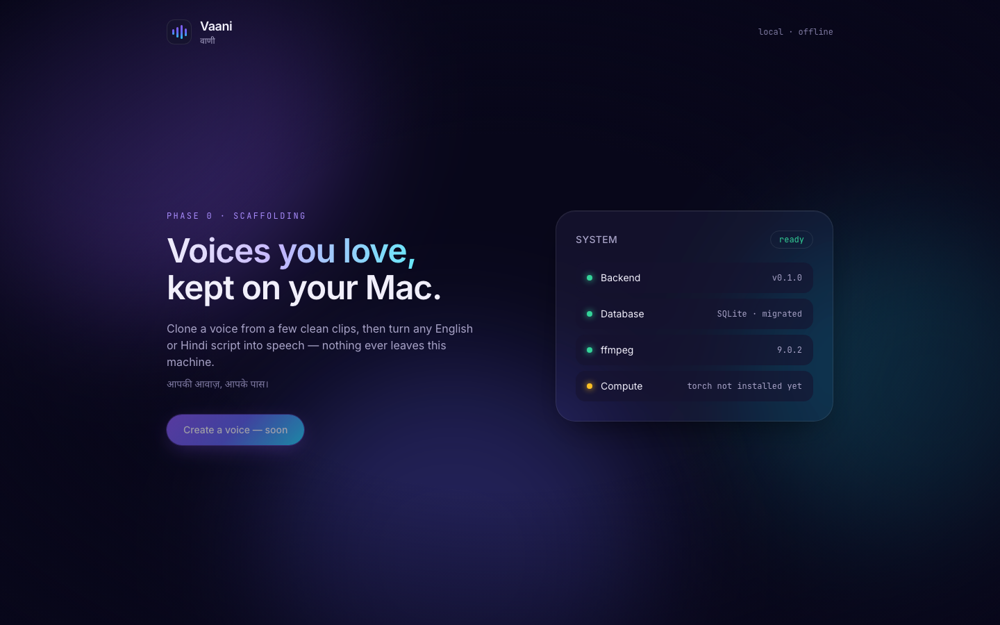
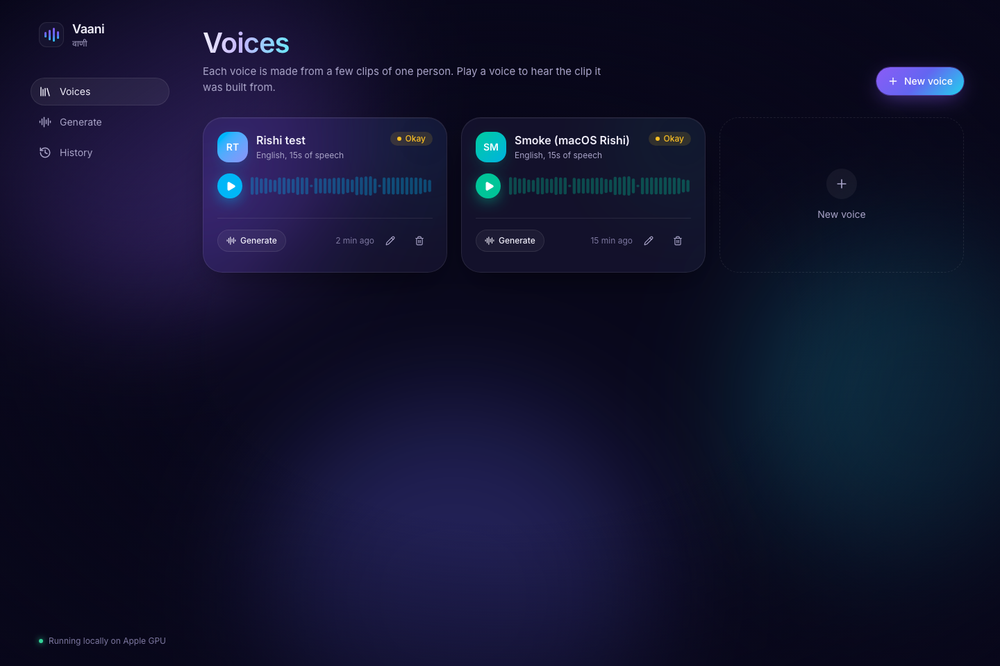
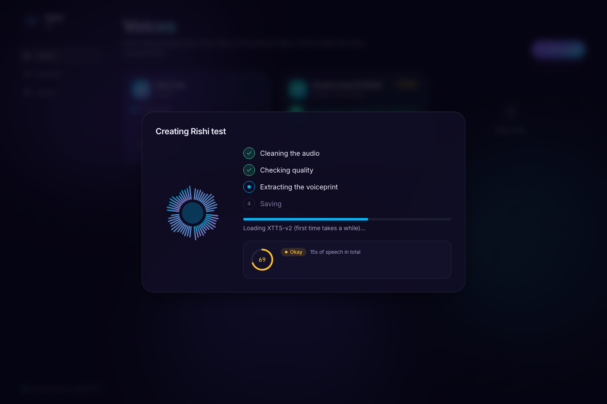

# Vaani · वाणी

A personal voice-cloning studio that runs **entirely on your own Mac**. Give it a few clean clips of someone's voice (with their permission). Then type a script in English, Hindi or a mix of both, and Vaani reads it back in that voice.

> **Local only.** Vaani is not a website or a cloud service, and there is nothing to deploy. It runs on your computer, and your recordings never leave it. You need a Mac with Apple Silicon (see [Prerequisites](#prerequisites)). After the first-time model downloads it works with the internet switched off.

**Status:** the core app works. Create a voice from uploads or the microphone, generate English, Hindi or Hinglish speech with live progress, then play, download and manage the results. The extras so far are auto-transcription, a pronunciation dictionary and pause markers.



| Voice library | Creating a voice |
|---|---|
|  |  |

## Features

**Core app (working)**
- 12 built-in voices (6 female, 6 male), ready to use straight away. They're studio speakers that ship with the XTTS-v2 model (English accent, non-commercial)
- Create a Voice from uploaded clips (wav/mp3/m4a/ogg) or a microphone recording
- Automatic cleanup: mono conversion, silence trimming, loudness normalising, optional denoise
- A quality check with a Good / Okay / Poor rating and the reasons for it
- A voice library: preview, rename, delete (deletion removes every file and record)
- A required consent note per voice
- Generate speech from long scripts, with natural pauses and live progress
- Generation history with replay, regenerate and download (WAV/MP3)
- Pause markers in scripts: `[pause 1s]`, `[pause 500ms]`, `[pause 2]` (seconds) or just `[pause]` (1 second), up to 10 seconds each. They show as chips in the editor and can be inserted with one click
- Subtitles: download SRT or WebVTT for any generation, timed to the audio, with speaker names in dialogues
- Multi-voice dialogue: start lines with a voice name, `[Papa]: …` / `[Meera]: …`, and get one recording with everyone speaking. Speaker tags show in each voice's colour, and the orb and highlight follow whoever is speaking
- A pronunciation dictionary for names and acronyms ("Vaani → Vaa-nee", "IIT → I I T"), with a live preview of what the voice will be given
- A "sounds like" score for every generation (an independent speaker-recognition model compares the result with the original clips), plus an original-vs-generated comparison
- Picks the engine that sounds most like the person: F5-TTS for English (measured 0.81 similarity to a real voice, against 0.63 for XTTS), XTTS for speed and Hindi
- Automatic transcription of every clip (Whisper, on the Apple GPU), with a Clips view to check and correct what was heard
- A dark, animated interface that respects reduced-motion settings

**Later:** speaking-style variants, batch generation, and side-by-side engine comparison.

## Prerequisites

### Hardware and system

| | Needed | Notes |
|---|---|---|
| Computer | **Mac with Apple Silicon** (M1, M2, M3, M4 or newer) | The voice engines and transcription use the Apple GPU (Metal / MLX). Intel Macs, Windows and Linux are not supported. |
| macOS | **13.5 Ventura or newer** | Required by MLX. Developed on macOS 26. |
| Memory | **16 GB recommended** | XTTS and Whisper together use about 5 GB while working. 8 GB may work but is untested. |
| Free disk | **About 8 GB** for the core app | Python packages ~1.2 GB, XTTS-v2 model 2.1 GB, Whisper model 1.6 GB, web packages ~0.3 GB, plus your recordings. The optional extra engines add ~5 GB. |
| Internet | Only for installing and the **first** run | Models download once into `data/models/`. After that everything works offline. |
| Browser | A current Chrome, Safari, Firefox or Edge | Allow microphone access if you want to record in the browser. |

### Software

| Tool | Version | Install |
|---|---|---|
| [Homebrew](https://brew.sh) | any | see brew.sh |
| git | any | `xcode-select --install` (if `git` is missing) |
| ffmpeg | 4–9 | `brew install ffmpeg` |
| uv (Python manager) | 0.5+ | `brew install uv`. It installs **Python 3.11** for you automatically. |
| Node.js | **22** (20.19+ works) | `brew install node@22` |
| pnpm | 9+ | `brew install pnpm` |

All in one go:

```bash
brew install ffmpeg uv node@22 pnpm
```

`node@22` is installed alongside any Node you already have. Put it first on your PATH for this project (or add the line to `~/.zshrc`):

```bash
export PATH=/opt/homebrew/opt/node@22/bin:$PATH
node --version   # should print v22.x
```

Accounts: **none** are needed for the core app. A free Hugging Face account is only needed for the optional IndicF5 engine.

## Setup and run

```bash
git clone https://github.com/frontendguru1/Vaani.git && cd Vaani
cp .env.example .env            # optional; every setting has a working default

# Backend — terminal 1
cd backend
uv sync                         # first time: downloads Python 3.11 + packages (~1.2 GB)
uv run vaani-dev                # http://127.0.0.1:8000  (creates/migrates the database)

# Frontend — terminal 2
cd frontend
pnpm install
pnpm dev                        # open http://localhost:5173
```

If you plan to commit changes, turn on the repo's safety check once per clone. It blocks any commit that contains a token, a private key, your recordings or a local `.env`:

```bash
git config core.hooksPath .githooks
```

**First run:** the backend downloads the XTTS-v2 voice model (2.1 GB) and sets up the 12 built-in voices in the background, about a minute after the download. Creating your first own voice also downloads the Whisper transcription model (1.6 GB). After that, voices are created in seconds and models stay loaded while the app runs.

To stop Vaani, press `Ctrl+C` in both terminals. Everything you made stays in `data/`.

### Optional extra voice engines

XTTS-v2 is built in. Two more engines can be added for comparison. Each lives in its own Python environment, because their libraries clash with XTTS's:

```bash
# F5-TTS MLX — fast-ish English on Apple Silicon (~1.4 GB model on first use)
uv venv --python 3.11 .venvs/f5mlx && VIRTUAL_ENV=.venvs/f5mlx uv pip install f5-tts-mlx soundfile

# IndicF5 — Hindi specialist (~1.4 GB). Gated: accept the terms at
# https://huggingface.co/ai4bharat/IndicF5, create a Read token, then:
backend/.venv/bin/hf auth login
uv venv --python 3.10 .venvs/indicf5 && VIRTUAL_ENV=.venvs/indicf5 uv pip install "git+https://github.com/ai4bharat/IndicF5.git" soundfile torchcodec "transformers<4.50" "numpy<=1.26.4" "datasets<4"
```

Both of these need a short reference clip (≤ 12–15 s) **and the exact words spoken in it**.

### Comparing engines (benchmark)

```bash
cd backend
uv run python scripts/benchmark_engines.py --ref ~/clips/me.wav --ref-text "the exact words in the clip"
```

It speaks a few English, Hindi and Hinglish sentences with every installed engine. It saves the audio to `data/benchmarks/<date-time>/` so you can listen, and prints how long each engine took.

| Measured on an M1-class Mac (synthetic reference voice) | Speed |
|---|---|
| XTTS-v2 on the Apple GPU (default) | about 2× faster than real time |
| XTTS-v2 on CPU | about 1.5× slower than real time |
| F5-TTS MLX | 2.5–5× slower than real time |
| IndicF5 (CPU only) | about 20× slower than real time |

### Tests

```bash
cd backend  && uv run pytest
cd frontend && pnpm test
```

### Maintenance

```bash
cd backend
uv run vaani check              # schema up to date? any orphaned files or missing files?
uv run vaani check --fix-orphans  # delete folders that no longer belong to any voice
uv run vaani migrate            # apply database migrations
uv run vaani reset-dev-data     # wipe all voices, generations and the database (keeps models)
```

## Configuration

All settings go in `.env` at the repo root. `.env.example` lists every option with comments, and none are required.

| Setting | Default | Meaning |
|---|---|---|
| `VAANI_DATA_DIR` | `data` | Where voices, generations, the database and models are stored |
| `DATABASE_URL` | SQLite in the data dir | Point this at Postgres later if wanted |
| `VAANI_DEVICE` | `auto` | `auto` uses the Apple GPU (MPS) and falls back to CPU |
| `VAANI_XTTS_DEVICE` | follows `VAANI_DEVICE` | Force XTTS onto `cpu` if GPU output ever sounds wrong |
| `VAANI_DEFAULT_ENGINE` | `auto` | `auto` picks the engine that sounds closest for each voice and language; or name one (`xtts`, `f5_mlx`, `indicf5`) to always use it |
| `VAANI_F5MLX_QUANT` | empty (full) | `8` or `4` for smaller, slightly lower-quality F5 weights |
| `VAANI_TRANSCRIBE_MODEL` | `mlx-community/whisper-large-v3-turbo` | Whisper model; `mlx-community/whisper-small-mlx` is 0.48 GB but weaker at Hindi |
| `VAANI_TRANSCRIBE_ON_CREATE` | `true` | Transcribe clips automatically when a voice is created |
| `VAANI_SEED_BUILTIN_VOICES` | `true` | Add the 12 built-in voices on first start |
| `VAANI_PAUSE_SENTENCE_MS` / `_PARAGRAPH_MS` / `_TURN_MS` | 350 / 800 / 500 | Pauses between sentences, paragraphs, and speakers in a dialogue |
| `VAANI_MAX_UPLOAD_MB` | 1024 | Largest upload per request (each file is also capped at 200 MB) |
| `VAANI_HOST` / `VAANI_PORT` | 127.0.0.1 / 8000 | Where the backend listens. Keep it on this machine. |

## Project structure

```
backend/    Python API (FastAPI), database models and migrations, voice engines
frontend/   Web interface (React, TypeScript, Tailwind, Motion)
data/       Your private data — voices, audio, database, models (never committed)
```

## API

Everything is under `/api/v1`. Interactive docs are at http://127.0.0.1:8000/docs.

| Call | What it does |
|---|---|
| `POST /voices` | Upload clips (multipart: `name`, `language`, `consent_note`, `files[]`). Returns the voice and a job id |
| `POST /voices/quality-check` | Rate a single clip without saving it |
| `GET /voices`, `GET/PATCH/DELETE /voices/{id}` | Voice library. DELETE removes every file and record |
| `GET /voices/{id}/preview` | Play the reference clip |
| `POST /generations` | `{voice_id, language, script, engine?, settings?}`. Returns a job id |
| `GET /generations`, `GET /generations/{id}` | History |
| `GET /generations/{id}/audio?format=wav\|mp3&download=true` | The result |
| `GET /generations/{id}/subtitles?format=srt\|vtt&download=true` | Subtitles timed to the audio |
| `POST /generations/{id}/regenerate`, `DELETE /generations/{id}` | |
| `GET /jobs/{id}`, `GET /jobs/{id}/events` | Job status, and live progress as Server-Sent Events |
| `GET/POST /pronunciations`, `PATCH/DELETE /pronunciations/{id}`, `POST /pronunciations/preview` | Pronunciation dictionary |
| `POST /voices/{id}/transcribe`, `PUT /voices/{id}/samples/{sid}/transcript` | Transcribe a voice's clips, correct a transcript |
| `GET /voices/builtin/missing`, `POST /voices/builtin/restore` | Built-in voices that were deleted, and bringing them back |
| `GET /engines`, `GET /health` | Installed engines, and system status |

## Voice models and licenses

| Engine | Good for | Download | License |
|---|---|---|---|
| [XTTS-v2](https://huggingface.co/coqui/XTTS-v2) via [coqui-tts](https://github.com/idiap/coqui-ai-TTS) | English + Hindi, baseline | 2.1 GB | Code MPL-2.0; weights **Coqui Public Model License (non-commercial)** |
| [IndicF5](https://huggingface.co/ai4bharat/IndicF5) (AI4Bharat) | Hindi quality | 1.4 GB | MIT; access requires accepting the terms on Hugging Face |
| [F5-TTS MLX](https://github.com/lucasnewman/f5-tts-mlx) | Fast English on Apple Silicon | 0.2–1.4 GB | Code MIT; weights license not stated (upstream F5-TTS weights are CC-BY-NC) |
| [SpeechBrain ECAPA](https://huggingface.co/speechbrain/spkrec-ecapa-voxceleb) | Similarity score and speaker check (not a voice engine) | 89 MB | Apache-2.0 |
| [Whisper large-v3-turbo](https://huggingface.co/mlx-community/whisper-large-v3-turbo) via mlx-whisper | Transcribing clips (not a voice engine) | 1.6 GB | MIT |

Which engines Vaani ships with depends on a listening test in Phase 1. **Vaani is for personal and family use only.** Do not use it commercially.

## Privacy and consent

- Everything stays on this computer. Vaani makes no network calls except the one-time model downloads.
- All recordings, voices and generated audio live in `data/`, which is excluded from git.
- Only clone a voice when that person has agreed, or when it's your own. Vaani asks for a consent note for each voice and refuses to generate without one.
- Deleting a voice permanently removes its recordings, cached voice data, generated audio (including any dialogue it spoke in) and database records. `uv run vaani check` confirms nothing was left behind.
- Vaani only answers requests addressed to `localhost`/`127.0.0.1`, and refuses uploads or deletions coming from other websites, so a page open in another browser tab can't reach your recordings.

## Troubleshooting

- **"Can't reach the backend" / "Backend offline":** start it with `cd backend && uv run vaani-dev`.
- **`uv sync` fails building a package:** make sure you're on Apple Silicon (`uname -m` prints `arm64`) and that the Xcode command-line tools are installed (`xcode-select --install`).
- **Microphone recording doesn't start:** allow the microphone for `localhost` in your browser's site settings.
- **`pnpm dev` fails with a Node version error:** you're on an older Node. Use the Node 22 PATH line above.
- **System card shows ffmpeg missing:** run `brew install ffmpeg`.
- **The first voice takes a minute:** XTTS-v2 is loading, or downloading on the very first run. Later voices and generations reuse the loaded model.
- **XTTS sounds wrong on the GPU:** force CPU with `VAANI_XTTS_DEVICE=cpu` in `.env` and compare.
- **IndicF5 shows "gated model":** accept its terms on Hugging Face, then run `backend/.venv/bin/hf auth login`.

## Roadmap

0. ✅ Scaffolding
1. 🎧 Quality spike: the benchmark is built; the listening test on a real voice is still to do
2. ✅ Backend core: voices, cleanup, quality checks, generation, history
3. ✅ Frontend: voice library, recording, generation studio, history
4. 🚧 Polish and extras: auto-transcription, pronunciation dictionary, pause markers, dialogue and subtitles done
5. Notes on fine-tuning (documentation only)
